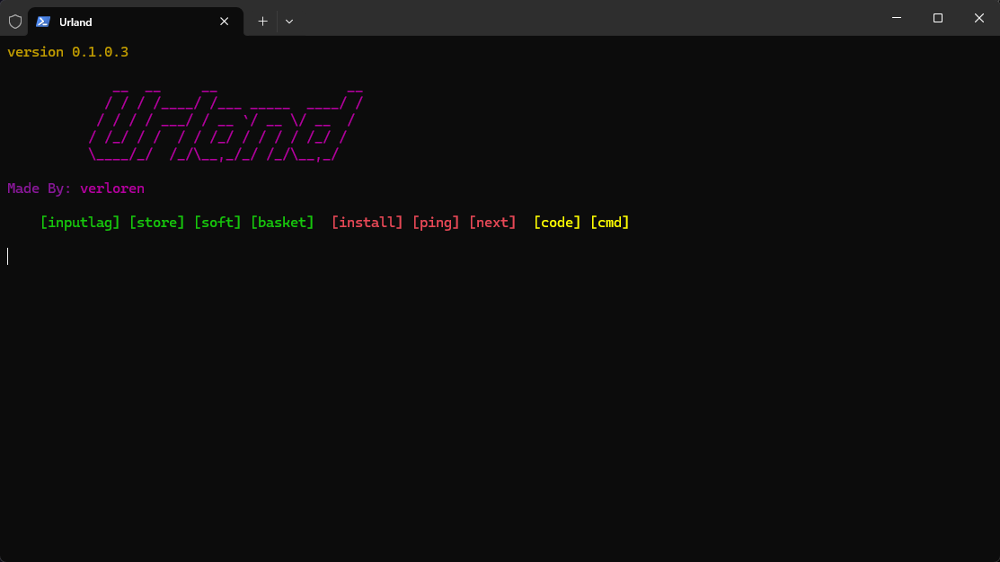
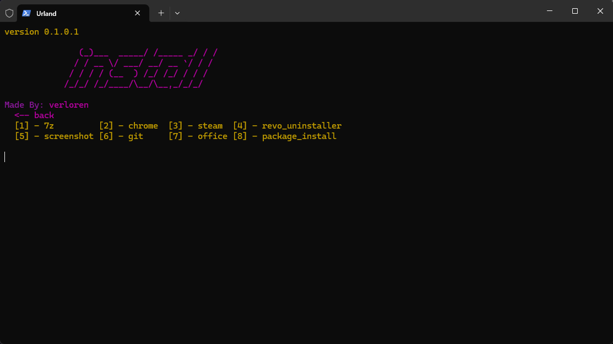
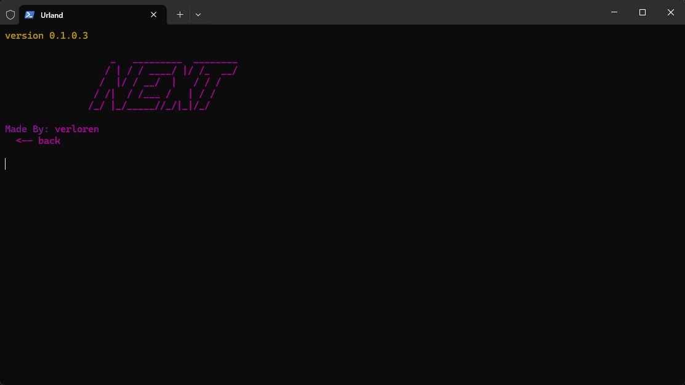

<h1 align="center">Urland v0.1.0.1</h1>

<h2 align="center">Сейчас программа ещё в стадий разработкий не которые фукций не работают</h2>

------------------------------
## :star2: Preview

<h2 align="center">Описания</h2>

<h3>Сейчас работает из функций next, install, ping, store, soft, basket, inputlag</h3>

- next это отдельное окно у нее другие функций они отличаются от Urland main окно которое вас встречает когда запускаете программу next ещё не допилинь и за этого пустой но есть команды exit, back команда back возвращает на Urland main а exit команда прикрашает работу программы.
- install окно для устоновок приложение на ваш компьютер (windows пока что) пока что не чего устоновить нельзя.
- store здесь собрано все онлайн магазины каторые я использовал возможно кому-то будет польезно.
- soft это мини веб сайт где собранны приложенией каторые я знаю и по моему опыту 
- basket если у вас нету корзины на рабочем столе то можно вести эту команду и вас перебросить за корзину 
- inputlag пока что лучшее её не использовать так как не проверил до конца можно сказать что не работает 

<h3> Пока что программа очень слобая но с каждой обновой будет только становится сильнее как и сам разработчик</h3>

-----------------------------------
РУССКИЙ (неофициальный перевод / unofficial translation)

Настоящим бесплатно предоставляется разрешение любому лицу, получившему копию
данного программного обеспечения и сопутствующей документации (далее —
«Программное обеспечение»), использовать Программное обеспечение без
ограничений, включая право использовать, копировать, изменять, объединять,
публиковать, распространять, сублицензировать и (или) продавать копии
Программного обеспечения, а также лицам, которым предоставляется
Программное обеспечение, при соблюдении следующих условий:

Указанное выше уведомление об авторских правах и данное разрешение должны быть
включены во все копии или значимые части Программного обеспечения.

ПРОГРАММНОЕ ОБЕСПЕЧЕНИЕ ПРЕДОСТАВЛЯЕТСЯ «КАК ЕСТЬ», БЕЗ КАКИХ-ЛИБО ГАРАНТИЙ,
ЯВНЫХ ИЛИ ПОДРАЗУМЕВАЕМЫХ, ВКЛЮЧАЯ ГАРАНТИИ ТОВАРНОЙ ПРИГОДНОСТИ,
СООТВЕТСТВИЯ ПО ЕГО КОНКРЕТНОМУ НАЗНАЧЕНИЮ И ОТСУТСТВИЯ НАРУШЕНИЙ ПРАВ. НИ В
КАКОМ СЛУЧАЕ АВТОРЫ ИЛИ ПРАВООБЛАДАТЕЛИ НЕ НЕСУТ ОТВЕТСТВЕННОСТИ ПО КАКИМ-ЛИБО
ИСКАМ, ЗА УЩЕРБ ИЛИ ПО ИНЫМ ТРЕБОВАНИЯМ, В ТОМ ЧИСЛЕ ПРИ ДЕЙСТВИИ КОНТРАКТА,
ДЕЛИКТЕ ИЛИ ИНОЙ СИТУАЦИИ, ВОЗНИКШИМ ИЗ-ЗА ИСПОЛЬЗОВАНИЯ ПРОГРАММНОГО
ОБЕСПЕЧЕНИЯ ИЛИ ИНЫХ ДЕЙСТВИЙ С ПРОГРАММНЫМ ОБЕСПЕЧЕНИЕМ.

ПОЛЬЗОВАТЕЛЬ ИСПОЛЬЗУЕТ ПРОГРАММНОЕ ОБЕСПЕЧЕНИЕ ИСКЛЮЧИТЕЛЬНО НА СВОЙ СТРАХ
И РИСК. АВТОР НЕ НЕСЁТ НИКАКОЙ ОТВЕТСТВЕННОСТИ ЗА ПОТЕРЮ ДАННЫХ, ПОВРЕЖДЕНИЕ
УСТРОЙСТВ, УПУЩЕННУЮ ВЫГОДУ, БЛОКИРОВКУ ИЛИ БАН АККАУНТОВ, ЮРИДИЧЕСКИЕ
ПОСЛЕДСТВИЯ И ЛЮБОЙ ИНОЙ ПРЯМОЙ ИЛИ КОСВЕННЫЙ УЩЕРБ, ВОЗНИКШИЙ В РЕЗУЛЬТАТЕ
ИСПОЛЬЗОВАНИЯ ИЛИ НЕВОЗМОЖНОСТИ ИСПОЛЬЗОВАНИЯ ПРОГРАММНОГО ОБЕСПЕЧЕНИЯ.

УВЕДОМЛЕНИЕ О БЕТА-ВЕРСИИ: ПРОГРАММНОЕ ОБЕСПЕЧЕНИЕ НАХОДИТСЯ НА СТАДИИ
БЕТА-ТЕСТИРОВАНИЯ И НЕ ЯВЛЯЕТСЯ ЗАВЕРШЁННЫМ ПРОДУКТОМ. ОНО МОЖЕТ СОДЕРЖАТЬ
ОШИБКИ, СБОИ И НЕДОРАБОТАННЫЕ ФУНКЦИИ, РАБОТАТЬ НЕКОРРЕКТНО ИЛИ НЕ РАБОТАТЬ
ВОВСЕ, А ТАКЖЕ МОЖЕТ БЫТЬ ИЗМЕНЕНО ИЛИ ПРЕКРАЩЕНО В ЛЮБОЙ МОМЕНТ БЕЗ
УВЕДОМЛЕНИЯ. ИСПОЛЬЗУЯ ПРОГРАММНОЕ ОБЕСПЕЧЕНИЕ, ПОЛЬЗОВАТЕЛЬ ПРИЗНАЁТ И
ПРИНИМАЕТ ЭТИ РИСКИ. АВТОР НЕ НЕСЁТ НИКАКОЙ ОТВЕТСТВЕННОСТИ ЗА ЛЮБЫЕ ПОСЛЕДСТВИЯ
ИСПОЛЬЗОВАНИЯ ЭТОГО НЕЗАВЕРШЁННОГО ПРОГРАММНОГО ОБЕСПЕЧЕНИЯ.

В случае расхождений между русской и английской версиями приоритет имеет
английская версия.

